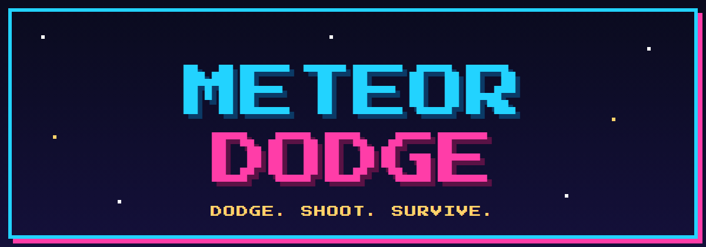

<p align="center">
  
</p>

A tiny retro space arcade game. Dodge meteors, shoot UFOs, beat bosses, survive as long as you can.

**[>> PLAY NOW <<](https://nafisiqbalneloy.github.io/meteor-dodge/)**

Free. No sign-up. Works on PC and phone. Fills the whole screen.

---

## CONTROLS

| | PC | PHONE |
|---|---|---|
| Move | Arrow keys or A / D | Drag your finger |
| Shoot | Space (hold) | Auto-fires while you drag |
| Pause | Esc | Pause button |
| Fullscreen | F | Fullscreen button |

- **Touch pad:** phones start with the on-screen buttons off. Turn them on with the TOUCH PAD button on the menu.
- **Gamepad:** plug one in. Stick or D-pad to move, A / X / triggers to shoot, Start to pause.

## HOW TO PLAY

- You have **3 lives**. A hit costs one.
- **Shoot** meteors to break them. Small ones take 1 hit, medium 2, large 3.
- **Stars** are worth 50 points.
- **Combo:** break meteors one after another to raise your score multiplier, up to x5. Getting hit resets it.
- The game speeds up every 15 seconds.
- Pick **Easy**, **Normal** or **Hard** on the menu. Your best score is saved in your browser.
- When the game ends you see your score, stars, bosses beaten and best combo.

## THINGS THAT FIGHT BACK

| | |
|---|---|
| **UFOs** | Small red saucers fly across and shoot at you. Shoot them for points and a chance at a power-up. |
| **Bosses** | A big boss drops in about every minute and gets angrier at 2/3 and 1/3 health. **Magma King** throws meteors, then rains a wall of them (find the gap). **Ice Eye** fires fans of bullets and throws meteors. **Laser Skull** fires beams (watch the red warning line, two beams at the end) and throws meteors. Beat one for 500 points, three stars and an extra life if you lost one. |
| **Black holes** | After about 20 seconds a black hole sometimes drifts down. It pulls your ship, bends meteors and swallows stars and power-ups. Stay away from the dark centre. |

## POWER-UPS

| ITEM | WHAT IT DOES |
|---|---|
| Cyan **S** orb | Shield for 6 seconds. |
| Purple **+** box | Adds a wingman plane. Grab two for a triple ship. Every plane shoots. They vanish after 10 seconds. |
| Orange **R** diamond | Rapid fire for 8 seconds. |
| Red **B** diamond | Bomb. Blows up every meteor and UFO on screen. |

## SHIPS

You start with STAR. Earn the others, then pick one on the menu.

| SHIP | STYLE | HOW TO GET IT |
|---|---|---|
| STAR | Balanced | Free |
| DART | Fast, small target | Score 1500 in one run |
| TANK | Slow, shoots fast | Beat a boss |
| VOID | Twin shot | Score 5000 in one run |

## LEVEL THEMES

About every 30 seconds (2 levels) the sky changes: Deep Space (purple), Toxic Nebula (green), Ice Field (icy blue), Lava Zone (red). Then it starts over. The mix of meteors changes too.

## EXTRAS

- **Music and sound** are made in code. Use the SOUND and MUSIC buttons to turn them off.
- **Vibration:** phones that support it buzz on hits and boss fights. SOUND off turns it off too. (iPhones do not support this.)
- **Install it:** use your browser's "Install" or "Add to Home Screen" to play it like an app, even offline.

## RUN IT YOURSELF

No install, no build. Download the files and open `index.html` in a browser.

Or run a small local server:

```
python -m http.server 8080
```

Then go to `http://localhost:8080`.

## PHONE TIPS

- On an iPhone, open the site in Safari and use Share > Add to Home Screen for the full-screen app.
- If something looks wrong in the installed app, tap the "METEOR" title 5 times on the menu. It shows the screen sizes the phone reports.

## BUILT WITH

HTML, CSS, plain JavaScript, Canvas and the Web Audio API. No libraries, no tracking, no outside requests.

## FILES

```
index.html      the page and menus
style.css       the pixel look
game.js         the game
manifest.json   app info (install)
sw.js           offline support
404.html        not-found page
og-image-v2.png link preview picture
assets/         icons, font, banner
```

## LICENSE

The game code is free to use and change under the MIT License (see `LICENSE`).

## CREDITS

Font: [Press Start 2P](https://fonts.google.com/specimen/Press+Start+2P) by CodeMan38, under the SIL Open Font License (see `assets/OFL.txt`).
